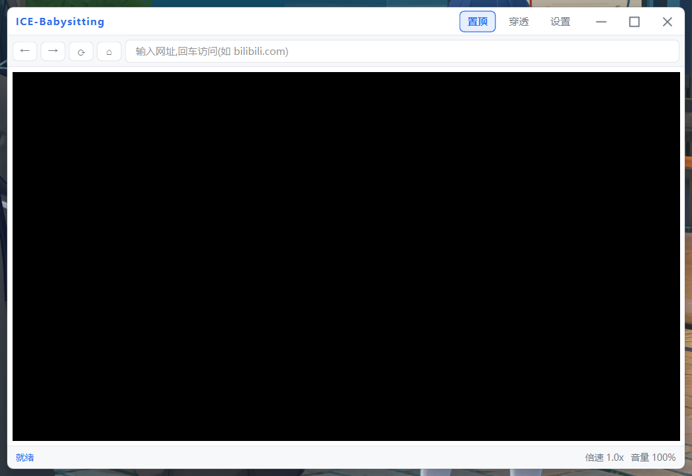
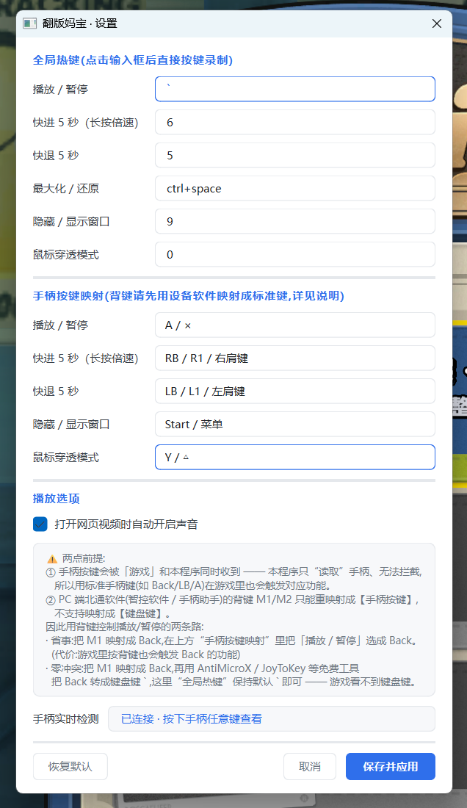

<div align="center">


# ICE-Babysitting

**打游戏时看攻略视频的小窗浏览器 —— 全局热键 + 手柄控制 + 鼠标穿透**

纯本地运行 · 无卡密 · 无服务器 · 无联网验证


</div>

---

## 📸 界面





## ✨ 功能

- **置顶小窗**:打游戏时看攻略 / 视频,窗口永远浮在最上层
- **全局热键**:游戏或任何软件在前台,直接按键控制视频,不用切回窗口
- **长按倍速**:短按快进 5 秒、**按住不放变 3 倍速**、松手恢复原速(和 B站 一个手感)
- **自动开启声音**:一进视频页自动解除静音(Chromium 自动播放策略导致默认静音),可关
- **手柄支持**:XInput 手柄映射播放 / 暂停、快进快退等,支持背键(见下)
- **沉浸穿透模式**:一键隐藏导航栏 + 鼠标穿透,按键即恢复
- **浅色圆角界面**:Win11 原生 DWM 圆角,白底浅色,不遮挡视线
- **无边框拖拽缩放**:边缘拖拽改大小,跨屏拖动不错位(物理像素实现)
- **热键可视化改绑**:点输入框、按下想绑的键即可,支持组合键,改完立即生效
- **登录态持久化**:配置 / 登录态 / 日志放在用户目录,更新程序不丢
- **单实例保护**:同一时间只运行一个,避免按键响应两次、配置互相覆盖

## ⌨️ 快捷键(默认,可在「设置」里改)

| 按键                         | 功能                           |
| -------------------------- | ---------------------------- |
| <code>\`</code>(Tab 上方反引号) | 播放 / 暂停                      |
| `6`                        | **短按**快进 5 秒 / **长按** 3 倍速播放 |
| `5`                        | 快退 5 秒(按住连续快退)               |
| `9`                        | 隐藏 / 显示窗口(隐藏时视频暂停、热键暂停)      |
| `0`                        | 穿透模式(隐藏导航栏 + 鼠标穿透),再按恢复      |
| `Ctrl+Space`               | 最大化 / 还原                     |

> 热键使用**低级键盘钩子**(`WH_KEYBOARD_LL` + 独立线程),游戏场景兼容;  
> 程序每 5 秒自检一次钩子,异常会自动重建。
>
> 程序请求管理员权限(exe 内嵌 `uac_admin`):游戏以管理员运行时,普通权限的  
> 键盘钩子收不到按键(UIPI 隔离),热键会全部失效。
>
> **改热键**:标题栏「设置」→ 点输入框 → 直接按下想绑的键(支持 `ctrl+space`、  
> `f8` 等组合键)→ 保存并应用,立即生效。

## 🕹️ 手柄支持

程序用 XInput 轮询手柄,默认映射如下(可在「设置」里改绑):

| 手柄按键       | 功能               |
| ---------- | ---------------- |
| A / ×      | 播放 / 暂停          |
| RB / R1    | 快进 5 秒 / 长按 3 倍速 |
| LB / L1    | 快退 5 秒(按住连发)     |
| Start / 菜单 | 隐藏 / 显示窗口        |
| Y / △      | 鼠标穿透             |

### 关于背键(M1 / M2 / P1-P4 拨片)

背键**不是**标准 XInput 按键,所以程序直接读不到它 —— 必须先用厂商软件  
把它"映射"成别的键。**注意:PC 端的手柄厂商软件通常只支持"手柄键 → 手柄键"  
的重映射,并不提供"手柄键 → 键盘键"**,所以只有下面两条路:

**路线 A · 零额外软件(推荐先试)**

1. 厂商软件里把背键 **M1 映射成 `Back`(视图键)**;
2. 本程序「设置」→ 把「播放 / 暂停」绑到 `Back / 视图`。

代价:背键在游戏里也会触发 `Back` 的功能(不少游戏里 `Back` = 开地图 / 背包)。

**路线 B · 游戏内零冲突(要"隐形"就用这条)**

1. 厂商软件里同样把 **M1 → `Back`**;
2. 装一个免费工具(开源 **AntiMicroX** 或 **JoyToKey**),新建配置把 `Back`  
   映射成键盘键 <code>\`</code>;
3. 本程序不用动 —— 「播放 / 暂停」默认就是 <code>\`</code>。

这条路能成立,是因为程序用低级键盘钩子接收按键,第三方工具"造"出来的键盘  
事件它收得到;而游戏进程收不到手柄键、这个小众键盘键又基本没人用,等于背键隐身。

> ⚠ 别把背键映射成 A / B / X / Y / LB / RB 这些游戏高频键 —— 会同时触发攻击、  
> 跳跃等操作。

## 📥 下载

到 [Releases](../../releases) 页面下载(安装包内附 `使用说明.txt`):

| 文件                               | 适合谁  | 说明                          |
| -------------------------------- | ---- | --------------------------- |
| `ICE-Babysitting-Setup-*.exe`    | 普通用户 | 安装向导,自动建快捷方式 + 卸载程序         |
| `ICE-Babysitting-*-portable.zip` | 想免安装 | 解压后双击 `ICE-Babysitting.exe` |

**运行要求**:Windows 10 / 11 64 位 + [WebView2 Runtime](https://developer.microsoft.com/microsoft-edge/webview2/)  
(Win11 与绝大多数 Win10 已自带)。

## 🚀 快速开始(从源码)

```bash
# 需要 Python 3.10+
python -m venv .venv
.venv\Scripts\python.exe -m pip install -r requirements.txt
.venv\Scripts\python.exe main.py
```

> 国内网络慢时给 pip 换镜像:  
> `pip config set global.index-url https://pypi.tuna.tsinghua.edu.cn/simple`

## 📦 构建与打包

```bash
# 生成图标 + 打包主程序(onedir,产物在 dist\ICE-Babysitting\)
.venv\Scripts\python.exe tools/make_icon.py
.venv\Scripts\python.exe -m PyInstaller --noconfirm --distpath dist --workpath build ICE-Babysitting.spec
```

`ICE-Babysitting.spec` 里 WebView2 原生 DLL 的路径是**动态探测**的,换机器 / 换 Python 环境都不用改。

打安装包见 `ICE-Babysitting-Setup.spec`(需先把 `dist\ICE-Babysitting\` 压成 `installer/payload.zip`),产物支持静默部署:

```
ICE-Babysitting-Setup.exe --silent [--dir "D:\ICE-Babysitting"] [--no-desktop] [--no-run]
```

## 📁 项目结构

```
├── main.py                     # 入口(单实例保护 + 启动流程)
├── app/
│   ├── __init__.py             # 应用名/版本/数据目录(含旧版本数据自动迁移)
│   ├── config.py               # 配置管理(线程安全,自动保存/恢复)
│   ├── hotkey_manager.py       # 全局热键(低级键盘钩子 + 长按/连发 + 自愈)
│   ├── gamepad.py              # 手柄支持(XInput 轮询 + 按键映射)
│   ├── settings_dialog.py      # 设置界面(热键 / 手柄按键可视化改绑)
│   ├── webview_container.py    # 浏览器核心(WebView2 + 视频控制)
│   ├── main_window.py          # 主窗口(无边框圆角 + 拖拽缩放 + 穿透)
│   ├── theme.py                # 浅色圆角主题(QSS)
│   ├── logger.py               # 日志
│   └── utils/win32_api.py      # Win32 封装(穿透 / 圆角 / 物理像素窗口操作)
├── installer/installer.py      # 安装向导(图形 + 静默安装)
├── tools/
│   ├── logo_designs.py         # 图标绘制件 + 多套构图方案
│   ├── logo_variants.py        # 生成方案总览预览(用于挑选)
│   └── make_icon.py            # 生成 assets/ice-babysitting.ico(多尺寸)
├── assets/                     # 图标资源
├── docs/                       # 截图 / 图标
├── ICE-Babysitting.spec        # 主程序打包配置(WebView2 DLL 路径动态探测)
├── ICE-Babysitting-Setup.spec  # 安装包打包配置
└── requirements.txt
```

## 🛠️ 技术栈

Python 3.10+ / PyQt6 / **WebView2**(qtwebview2 + 系统自带 Edge Chromium 内核)/  
pythonnet / pywin32

> **为什么用 WebView2 而不是 QtWebEngine**:WebView2 用的是系统自带的 Edge 现代  
> Chromium 内核,更新及时、对新网站支持最好。QtWebEngine 自带内核版本较旧  
> (Chromium 83),实测在 B站 上封面点击不跳转、播放器渲染不出来。

## 💾 数据存放位置

配置、登录态、日志都在用户目录:

```
C:\Users\<你的用户名>\.ice-babysitting\
├── config.json      # 配置(热键、手柄映射、窗口状态、播放选项)
├── profile\         # WebView2 用户数据(B站登录态在这里)
└── logs\            # 运行日志
```

- **升级不丢数据**:程序与数据分离,替换程序文件不影响登录态。
- **自动迁移**:旧版本把数据放在程序目录下时,首次启动会自动搬到用户目录,  
  且**不覆盖**新位置已有的数据。
- **便携模式**:设环境变量 `ICE_BABYSITTING_CONFIG_DIR` 指向任意目录即可。

## 📝 开发排坑记录

1. **WebView2 需系统 Runtime**;PyInstaller 打包要手动把 `qtwebview2/lib` 放进  
   `_internal/lib`,路径不能错(否则启动即崩)
2. **跨屏拖动"越拖越大"**:多显示器缩放不同时,用逻辑坐标拖动会与 Qt 的 DPI  
   适配叠成正反馈 → 改用 `GetCursorPos` + `SetWindowPos` 物理像素操作,并给  
   窗口几何加合法性收敛
3. **无边框窗口原生圆角**:必须用 DWM 的 `DWMWA_WINDOW_CORNER_PREFERENCE`,  
   Qt 自己画 `border-radius` 圆不到 WebView2 那层原生子窗口
4. **Chromium 自动播放策略**:无用户手势的自动播放会被强制静音 →  
   监听 `play` 事件解除静音(每个 video 只做一次,之后尊重用户手动静音)
5. **按住键系统会连发 `KEYDOWN`** → 热键按物理按下/松开去重,否则长按会疯狂触发
6. **`threading.Lock` 不可重入**:持锁时再调 `save()` 会死锁,先释放锁再落盘
7. **Chromium 在未激活窗口不处理 hover** → 鼠标移入时自动激活窗口
8. **`QBuffer(QByteArray())` 会段错误**:临时 `QByteArray` 被 GC 后缓冲区悬空,  
   必须用无参 `QBuffer()`

## ⚖️ 免责声明

本工具为纯本地运行的学习项目,请勿用于商业用途。

## 📄 License

[MIT](LICENSE)
